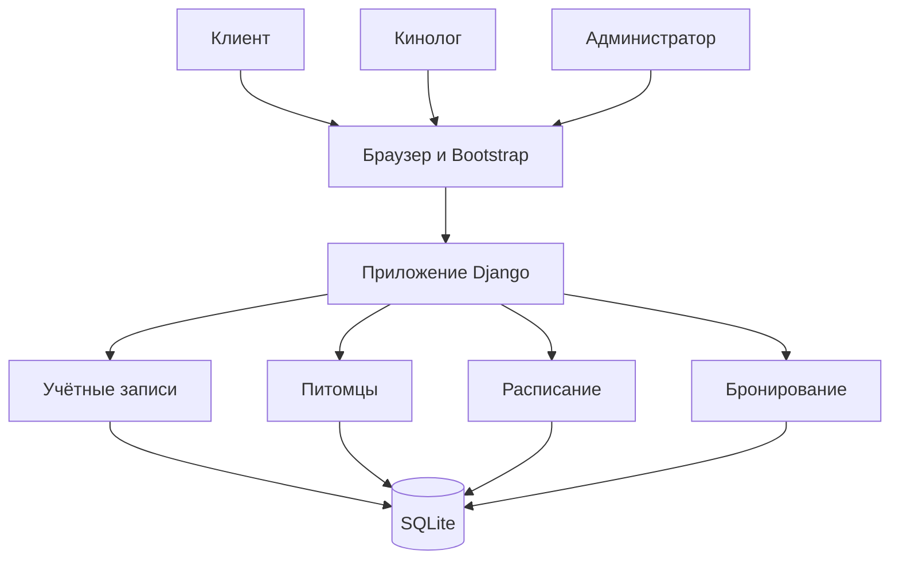
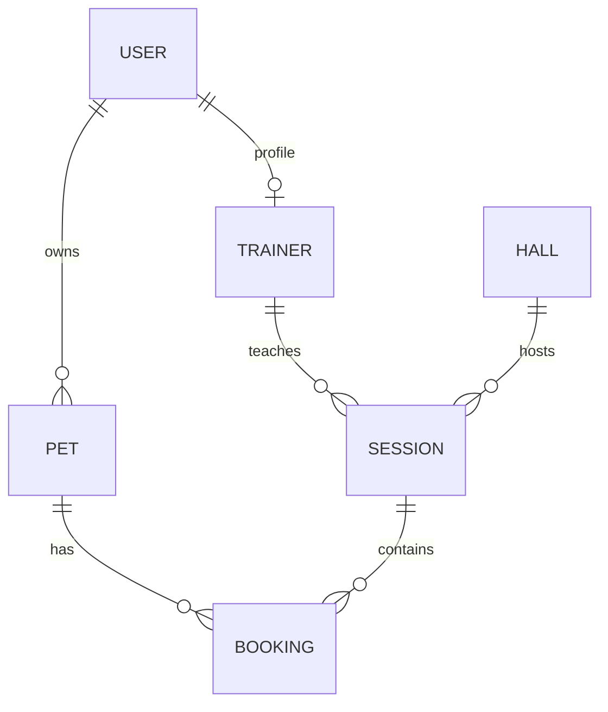
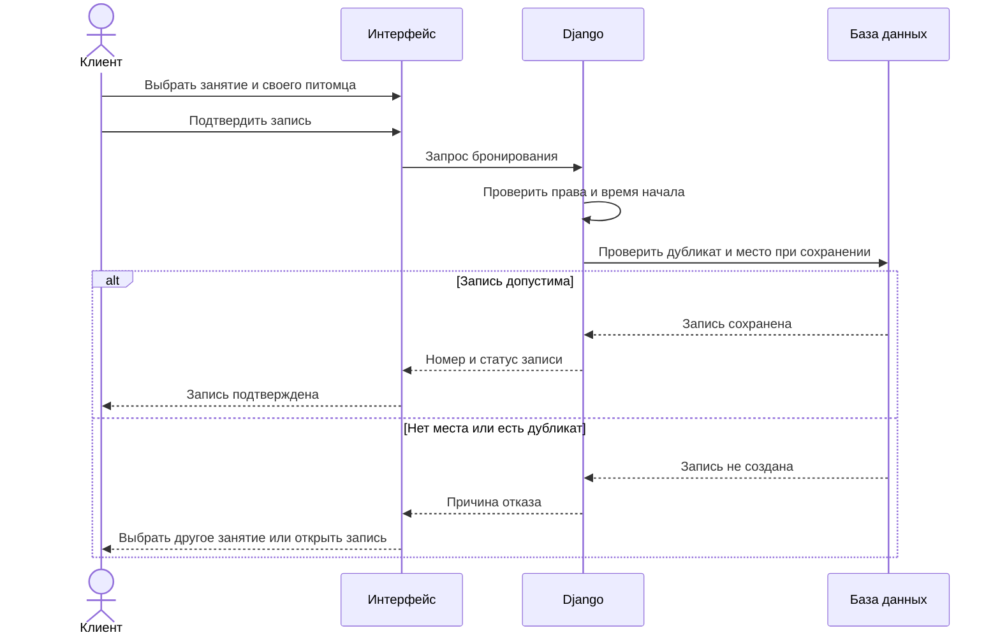

# Диаграммы проекта

Диаграммы описывают проектируемую структуру из `architecture.md` и процесс UC-01. Они подготовлены для этой версии документации. Блоки Mermaid можно просматривать в GitHub.

## Компоненты

## Связи сущностей

Каждый питомец принадлежит одному пользователю. Каждое занятие проводится одним кинологом в одном зале. Каждая запись относится к одному питомцу и одному занятию.

## Подтверждение бронирования

