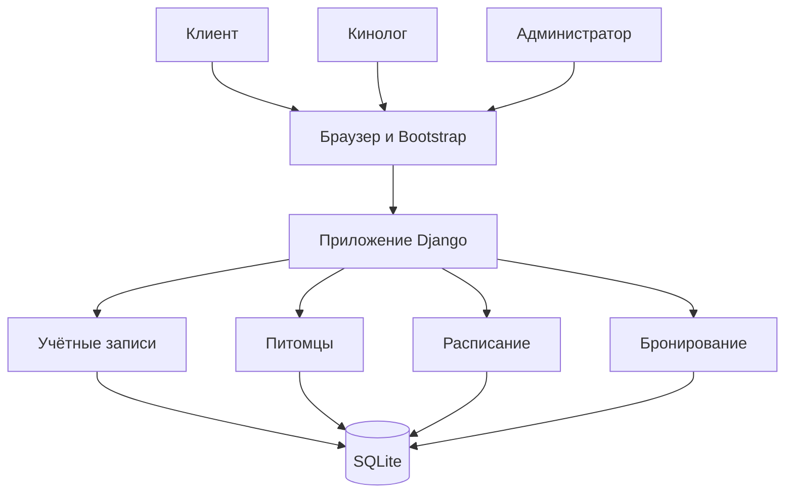
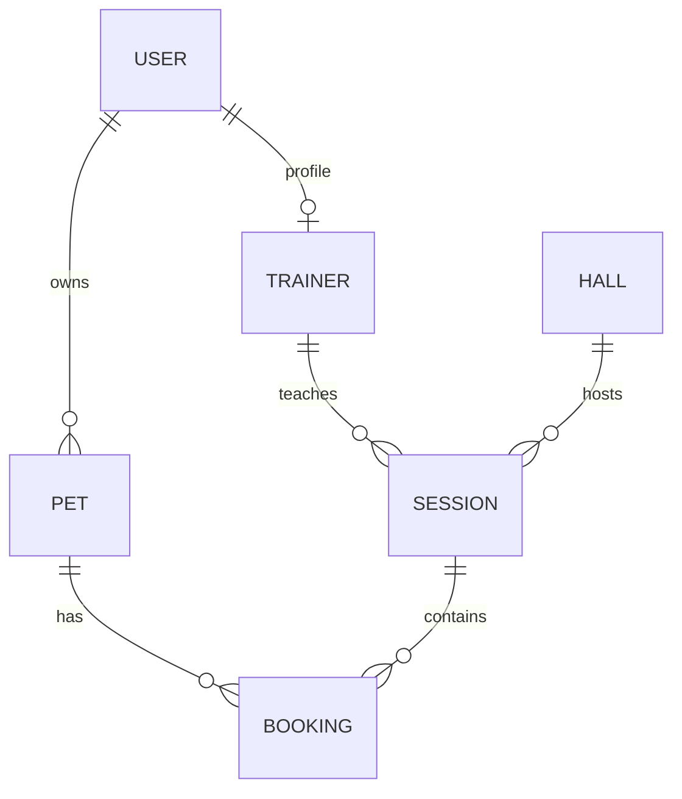
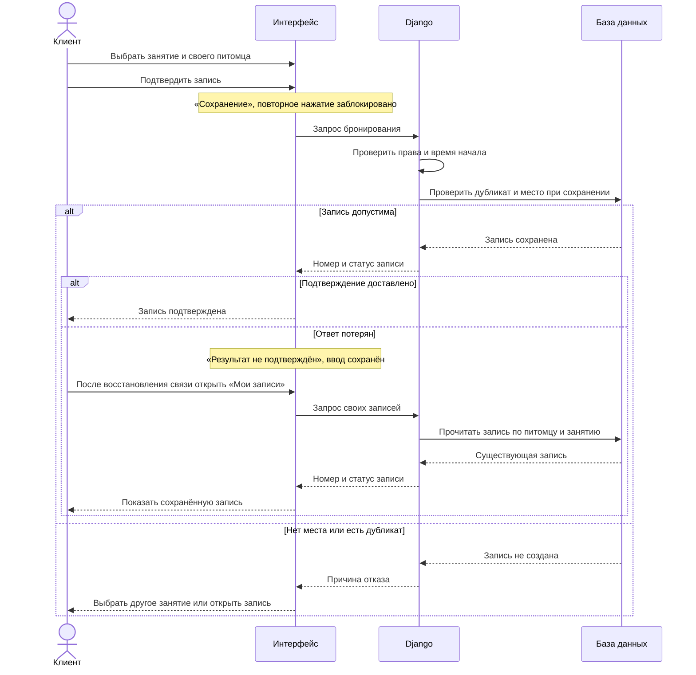
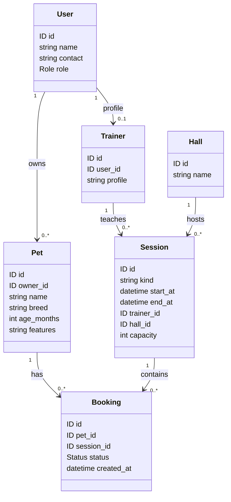

# Диаграммы проекта

Диаграммы описывают проектируемую структуру из `architecture.md` и процесс UC-01. Они подготовлены для этой версии документации. Блоки Mermaid можно просматривать в GitHub.

## Компоненты

## Связи сущностей

Каждый питомец принадлежит одному пользователю. Каждое занятие проводится одним кинологом в одном зале. Каждая запись относится к одному питомцу и одному занятию.

## Подтверждение бронирования

## Диаграмма проектных классов

Диаграмма описывает модель документации, а не наличие реализованных классов Python. Классы соответствуют одноимённым сущностям из архитектуры; AGE_MONTHS означает возраст в полных месяцах, START_AT и END_AT — моменты начала и окончания.

Pet.name: длина после удаления крайних пробелов 1–60; Pet.age_months: необязательное целое ≥ 0. Session.capacity: положительное целое; end_at > start_at. Booking.status принимает «Подтверждена», «Отменена», «Завершена». Role и Status — типы значений полей, а не дополнительные классы предметной области.
